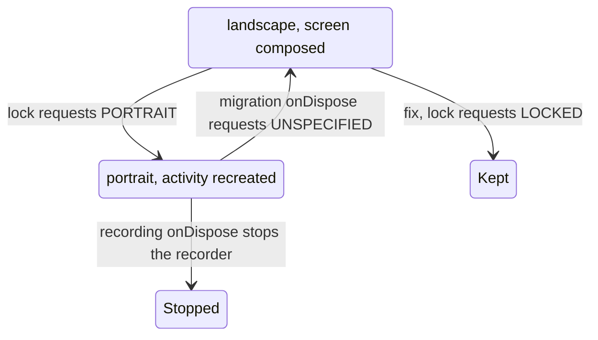

# Android: orientation locks stop tap-to-stop recording and loop "Migrate to another device"

## Problem

On a display that is landscape at rotation 0 (Waydroid in a landscape window, landscape tablets, Chromebooks; Android 16 ignores portrait requests at sw600dp and above):

- Tap-to-stop voice recording ends at once, and a 0:00 voice message is left in the compose field.
- "Migrate to another device" and the onboarding "Migrate here" screen never open: the activity is recreated in a loop.

## Cause

Only `android:configChanges="uiMode"` is declared for `MainActivity`, so the activity is recreated on a change of orientation.

- In `LockToCurrentOrientationUntilDispose()` (`UI.android.kt`, called in `RecordVoiceView`), `Surface.ROTATION_0` was mapped to `SCREEN_ORIENTATION_PORTRAIT`, which is not the current orientation on such a display. On the recreation, `RecordVoiceView` is disposed, and the recorder is stopped in its `onDispose`.
- In `androidLockPortraitOrientation()` (`SimplexApp.kt`, called in `MigrateFromDeviceLayout` and `MigrateToDeviceLayout`), `SCREEN_ORIENTATION_PORTRAIT` was requested. On the recreation, the screen is disposed and `SCREEN_ORIENTATION_UNSPECIFIED` is requested in its `onDispose`; the display returns to landscape, the activity is recreated again, and portrait is requested again for the new screen.

## Fix

In `LockToCurrentOrientationUntilDispose()`, `SCREEN_ORIENTATION_LOCKED` is requested, which keeps the current rotation. The same function is called in the migration screens in place of `androidLockPortraitOrientation()`, which is removed. Each lock is released, as before, when its screen is removed from the composition.

## Scope

- Android only: the desktop `LockToCurrentOrientationUntilDispose()` is empty, and on iOS an orientation is requested in neither migration nor recording.
- During migration, a phone held in landscape now stays in landscape; the progress ring and the archive link QR code are sized for landscape in `2026-11-07-android-migration-progress-landscape.md`.
- Unchanged: the activity is still recreated on a window resize during tap-to-stop recording or migration, and on a rotation or window resize during hold-to-record.
