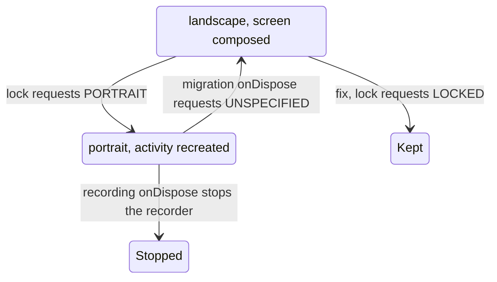

# Android: orientation locks stop tap-to-stop recording and loop "Migrate to another device"

## Problem

On a display that is landscape at rotation 0 (Waydroid in a landscape window, landscape tablets, Chromebooks; Android 16 ignores portrait requests at sw600dp and above):

- Tap-to-stop voice recording ends at once and leaves a 0:00 voice message in the compose field.
- "Migrate to another device" and the onboarding "Migrate here" screen never open: the activity is recreated in a loop.

## Cause

`MainActivity` declares only `android:configChanges="uiMode"`, so a change of orientation recreates it.

- `LockToCurrentOrientationUntilDispose()` (`UI.android.kt`, called by `RecordVoiceView`) mapped `Surface.ROTATION_0` to `SCREEN_ORIENTATION_PORTRAIT`, which is not the current orientation on such a display. The recreation disposes `RecordVoiceView`, whose `onDispose` stops the recorder.
- `androidLockPortraitOrientation()` (`SimplexApp.kt`, called by `MigrateFromDeviceLayout` and `MigrateToDeviceLayout`) requested `SCREEN_ORIENTATION_PORTRAIT`. The recreation disposes the screen, whose `onDispose` requests `SCREEN_ORIENTATION_UNSPECIFIED`, the display returns to landscape, the activity is recreated again and the new screen requests portrait again.

## Fix

`LockToCurrentOrientationUntilDispose()` requests `SCREEN_ORIENTATION_LOCKED`, which keeps the current rotation. The migration screens call it in place of `androidLockPortraitOrientation()`, which is removed. Each lock is released, as before, when its screen leaves the composition.

## Scope

- Android only: the desktop `LockToCurrentOrientationUntilDispose()` is empty, and iOS migration and recording set no orientation.
- Migration now keeps a landscape phone in landscape; the progress ring and the archive link QR code are sized for it in `2026-11-07-android-migration-progress-landscape.md`.
- Unchanged: a window resize during tap-to-stop recording or migration, and a rotation or window resize during hold-to-record, still recreate the activity.
