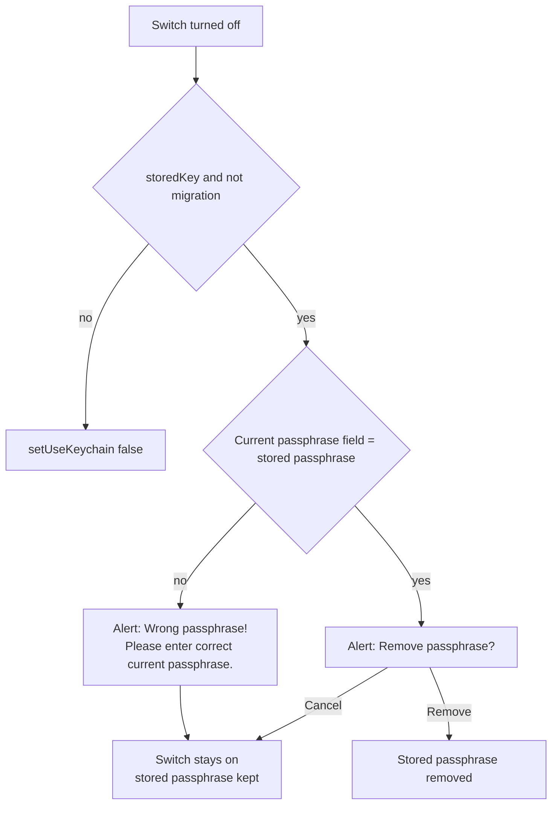

# Plan: verify the database passphrase before it is removed from the Keystore

## Problem

A user turned off "Save passphrase in Keystore" in Settings → Database passphrase, then failed to change the passphrase, and lost access to the database.

1. The switch was turned off, and the removal was confirmed.
2. A new passphrase was entered. The change failed, because the current passphrase was unknown.
3. The switch was turned on again.
4. After a restart, the app reported `ErrorNotADatabase` for `files_chat.db`.

The database remains encrypted with the old passphrase. That passphrase was stored only in the Keystore, and it was deleted in step 1. The database exports are encrypted with the same passphrase.

Android, desktop and iOS share this flow.

## Cause

Turning off the switch deletes the stored passphrase after a confirmation alert. The alert does not ask for the passphrase.

Kotlin, `DatabaseEncryptionView.kt:137-141`:

```kotlin
} else if (storedKey.value && !migration) {
  removePassphraseAlert {
    removePassphraseFromKeyChain(useKeychain, storedKey, false)
  }
}
```

`removePassphraseFromKeyChain` (`:308`) calls `ksDatabasePassword.remove()`. It deletes the Keystore key and the encrypted passphrase (`DatabaseUtils.kt` `KeyStoreItem.remove`).

iOS, `DatabaseEncryptionView.swift:76-78`: `alert = .keychainRemoveKey` → `removePassphraseFromKeyChain()` (`:275`) → `kcDatabasePassword.remove()`.

After the removal:
- a passphrase change requires the current passphrase (`hasCurrentField`, Kotlin `:147`; iOS `:86`);
- the database opens only with the current passphrase.

Other removal sites delete the stored passphrase in one of two cases: the database is deleted or replaced, or the passphrase was just entered by the user.

| Site | Case |
|---|---|
| Kotlin `DatabaseEncryptionView.kt:480`, iOS `DatabaseEncryptionView.swift:174` | after a successful change to a new passphrase |
| Kotlin `DatabaseView.kt:551`, `:577`, iOS `DatabaseView.swift:661`, `FileUtils.swift:128` | database deleted |
| Kotlin `DatabaseView.kt:724`, iOS `DatabaseView.swift:512` | database replaced by import |
| Kotlin `MigrateToDevice.kt:674`, iOS `MigrateToDevice.swift:583` | passphrase entered for the migrated database |
| iOS `AppDelegate.swift:120` | database absent |
| Kotlin `Core.kt:89` | `storeDBPassphrase` off, which is set only after one of the removals above |

## Fix

The switch removes the stored passphrase only when the "Current passphrase" field equals the stored passphrase.



The "Current passphrase" field is already on screen whenever the switch can be turned off with a stored passphrase. The switch is enabled outside migration only when `initialRandomDBPassphrase` is false (Kotlin `:133`, iOS `:83`). The field is shown when `initialRandomDBPassphrase` is false and the database is encrypted. A stored passphrase means that the database is encrypted.

The fix adds no strings. The alert reuses:
- Kotlin: `wrong_passphrase_title` and `enter_correct_current_passphrase` (`strings.xml:1720`, `:1688`);
- iOS: `.currentPassphraseError` (`DatabaseEncryptionView.swift:265`).

### Kotlin, `DatabaseEncryptionView.kt`

```kotlin
} else if (storedKey.value && !migration) {
  if (currentKey.value != DatabaseUtils.ksDatabasePassword.get()) {
    AlertManager.shared.showAlertMsg(
      generalGetString(MR.strings.wrong_passphrase_title),
      generalGetString(MR.strings.enter_correct_current_passphrase)
    )
  } else {
    removePassphraseAlert {
      removePassphraseFromKeyChain(useKeychain, storedKey, false)
    }
  }
}
```

The switch state is `useKeychain.value`, which this branch leaves unchanged, so the switch stays on.

### iOS, `DatabaseEncryptionView.swift`

```swift
} else if storedKey && !migration {
    if currentKey != kcDatabasePassword.get() {
        alert = .currentPassphraseError
        withAnimation { useKeychainToggle = true }
    } else {
        alert = .keychainRemoveKey
    }
}
```

`useKeychainToggle = true` turns the switch back on, as the Cancel button of `.keychainRemoveKey` does (`:232`).

### Specs

One line each:
- `apps/multiplatform/spec/database.md`, "Passphrase Management": "The stored passphrase is removed from the Keystore only after the current passphrase is entered."
- `apps/ios/spec/database.md`, "Key Storage": "The stored passphrase is removed from the Keychain only after the current passphrase is entered."

### Size

| File | Lines |
|---|---|
| `apps/multiplatform/common/src/commonMain/kotlin/chat/simplex/common/views/database/DatabaseEncryptionView.kt` | about 8 |
| `apps/ios/Shared/Views/Database/DatabaseEncryptionView.swift` | about 6 |
| `apps/multiplatform/spec/database.md` | 1 |
| `apps/ios/spec/database.md` | 1 |

## Option 2: remove the passphrase only after a successful change

This option is not included.

- With the fix above, the passphrase is removed only after the user has entered it, so the change that follows can still be made.
- Option 2 also leaves unverified the removal made without a passphrase change.

## Threat model

- A person with the unlocked device can no longer remove the stored passphrase without knowing it.
- The comparison is made locally, between the field and the stored value. It adds no database access and no core call.

## Tests

| Platform | Run |
|---|---|
| desktop | desktop-linux |
| Android | android-emu |
| iOS | ios-sim |

| Case | Expected |
|---|---|
| switch off, field empty | wrong-passphrase alert, switch on, database opens after restart |
| switch off, wrong passphrase | wrong-passphrase alert, switch on, database opens after restart |
| switch off, correct passphrase, Remove | stored passphrase removed, passphrase asked after restart |
| switch off, correct passphrase, Cancel | switch on, database opens after restart |
| random initial passphrase | switch disabled, as before |
| migration flow | unchanged |
