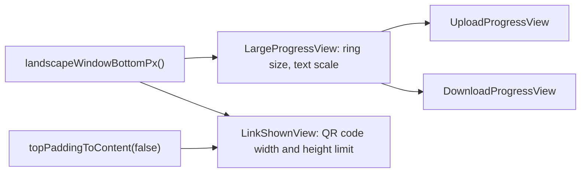

# Android: migration progress ring and QR code do not fit the screen in landscape

## Problem

With the migration screens kept in landscape (`2026-10-18-android-orientation-lock-recreate.md`):

- the upload and download progress ring of migration is about two screens tall, and its percentage is off screen until the user scrolls;
- the QR code of the uploaded archive link is taller than the visible area on a phone, so the other device cannot scan it.

## Cause

- In `LargeProgressView` (`MigrateFromDevice.kt`, called in `UploadProgressView` and `DownloadProgressView`), the ring is sized to the window width on Android.
- In `LinkShownView` (`MigrateFromDevice.kt`), `SimpleXLinkQRCode` is sized to the section width minus its padding, up to 400dp.

## Fix

The value of the new `landscapeWindowBottomPx()` is, in landscape on Android, the window height minus the bottom bars (the navigation bar, plus the app bar with the one-hand UI), and null elsewhere.

In landscape on Android:

- In `LargeProgressView`, the ring is sized to the height between the top of its box and that bottom, minus the padding, at least 120dp. The percentage and byte count are scaled by ring size / 300dp, between 0.4 and 1.
- In `LinkShownView`, the QR code with its vertical padding is limited to the height between `topPaddingToContent(false)` and that bottom, and centred. Its intrinsic height, from which the screen height is computed in `ColumnWithScrollBar(maxIntrinsicSize = true)`, is limited to the same height.

## Scope

- Sizes in portrait on Android and on desktop are unchanged.
