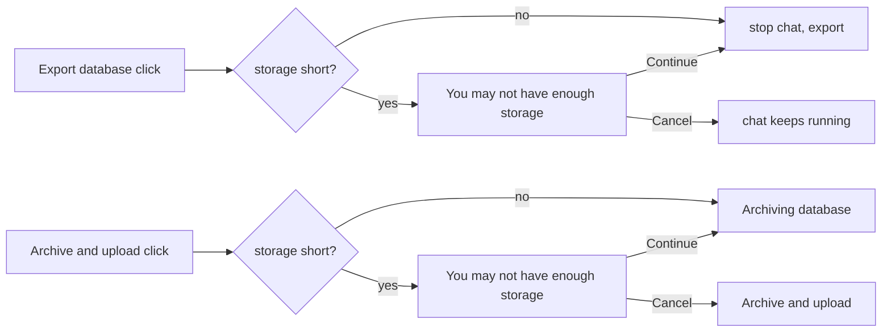
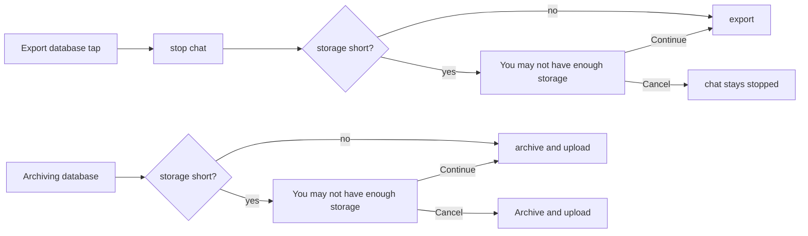

# Export and migration: warn when free space is short

## Problem

"Export database" and "Migrate to another device" start without checking free space. On a nearly full device the export fails or fills the disk.

## Cause

The core export copies both databases, the files and the wallpapers to a temporary folder, then writes the archive of that copy (`exportArchive`, `Archive.hs`). For a migration upload, the XFTP agent then writes an encrypted copy of the archive into the migration folder. About twice the data size is needed, and neither app compares it with free space.

## Fix

- Before "Export database" and before archiving for migration, the data size (`exportDataBytes`) is compared with free space. If short, "You may not have enough storage" shows the space needed and the space available, with Continue and Cancel. On Continue the step proceeds as before; on Cancel it is not started (migration stays at or returns to "Archive and upload").
- Android, desktop: with `exportStorageShortfall(exportFreeBytes, archiveFreeBytes, dataBytes)` in `DatabaseView.kt`, twice the data size is required free in the archive folder (the export folder, or `migration_temp_files` for migration) and the data size in the export folder. `confirmExportStorage` is called on the "Export database" click before the chat is stopped, and on the "Archive and upload" click before the state is set to "Archiving database".
- iOS: with `exportStorageShortfall`, twice the data size is required in `volumeAvailableCapacityForImportantUsage` of the documents volume.
- Strings: `not_enough_storage_title`, `not_enough_storage_desc`.

Android, desktop:

iOS:

## Scope

- Android, desktop: `DatabaseView.kt`, `MigrateFromDevice.kt`, `strings.xml`.
- iOS: `DatabaseView.swift`, `MigrateFromDevice.swift`.
- "Migrate here" and "Import database" are unchanged.
