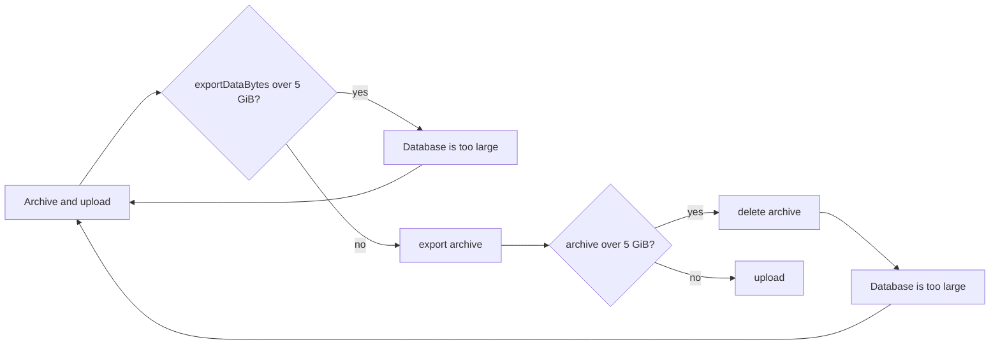

# Migration: refuse data over the XFTP upload limit before exporting

Part 1 of #7696.

## Problem

"Migrate to another device" exports the whole database and files, then fails at the upload with "Error uploading the archive" when the archive is over 5 GB. On Android and desktop the alert text is `chat.simplex.common.model.API$Error@…`. "Repeat upload" fails again, and the archive stays in the migration folder until the screen is closed.

## Cause

`APIUploadStandaloneFile` rejects a file over `maxFileSizeHard` (5 GiB, simplexmq `Simplex.FileTransfer.Description`) with `CEFileSize`. On the migration screen, both apps export and upload without checking that limit.

## Fix

- `MAX_FILE_SIZE_XFTP_HARD` = 5 GiB in Kotlin `Utils.kt` and Swift `FileUtils.swift`, separate from the badge tier `MAX_FILE_SIZE_XFTP_LEGEND`. Kotlin `exceedsXftpUploadLimit` is `bytes > MAX_FILE_SIZE_XFTP_HARD`, the comparison of the core.
- Before archiving, the data size is estimated: the top-level files of the files and wallpapers folders plus both databases (`exportDataBytes`); in Kotlin in `confirmArchiving` on the "Archive and upload" click, in Swift in `exportArchive`. Over the limit, "Database is too large" shows the size and the limit, and the state stays at or returns to "Archive and upload".
- After archiving, the archive size is compared with the limit before the "Chat database exported" alert of archive errors and before the upload. Over the limit, the archive is deleted and the same alert is shown.
- Strings: `migrate_from_device_database_too_large_title`, `migrate_from_device_database_too_large_desc`.

## Scope

- Android, desktop: `MigrateFromDevice.kt`, `DatabaseView.kt` (`exportDataBytes`), `Utils.kt`, `strings.xml`.
- iOS: `MigrateFromDevice.swift`, `FileUtils.swift`.
