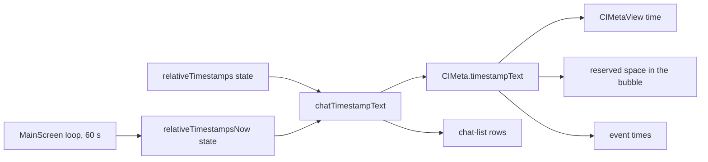

# Relative timestamps

## Problem

The chat list and the messages show only clock times (`12:00`, `02/01`). A reader works out the age of a message from the current time.

## Cause

The app formats these times only with `getTimestampText`, which returns a clock time or a date.

## Fix

- Preference `relativeTimestamps` (key `RelativeTimestamps`, off by default), toggle "Relative timestamps" in its own Appearance section, before the font scale section, on Android and desktop.
- `getRelativeTimestampText(t, now)`:

  | Age | Text |
  |---|---|
  | under 1 minute, or in the future | `just now` |
  | under 1 hour | `5m ago` |
  | under 1 day | `2h5m ago` |
  | under 365 days | `182d ago` |
  | 365 days or more | `1y100d ago` |

- `relativeTimestampsNow`: one `Instant` state. `MainScreen` sets it to the current time when the preference is on and every 60 s after that; the loop ends when the preference is off.
- `chatTimestampText(t, shortFormat)` reads the preference state and `relativeTimestampsNow`: an age when on, `getTimestampText` when off. A composition that shows a time reads both states, so it is recomposed on each update and on each toggle.
- `chatTimestampText` replaces `getTimestampText` in `CIMeta.timestampText` (message and event times) and in the chat-list rows (`ChatPreviewView`, `ContactRequestView`, `ContactConnectionView`).
- The space reserved for the time in a bubble (`reserveSpaceForMeta`, `metaReserveCopy`) is built from `CIMeta.timestampText`, so it equals the shown text in both modes.
- `getItemSeparation` compares the clock times of adjacent items (`getTimestampText(itemTs, true)`), so the items that show a time do not change as ages advance.

## Scope

- Android and desktop (`apps/multiplatform`). iOS is unchanged.
- Unchanged: date separators, the floating date, message info, share text, server statistics, badge pages, file expiry texts.
- The preference is local to the device; it is absent from the exported app settings.
