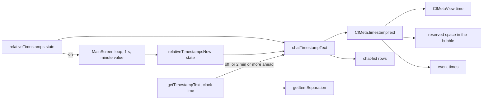

# Relative timestamps

## Problem

Only clock times and dates (`12:00`, `02/01`) are shown in the chat list and the messages. The age of a message is worked out by the reader from the current time.

## Cause

These times are formatted only by `getTimestampText`, whose result is a clock time or a date.

## Fix

- Preference `relativeTimestamps` (key `RelativeTimestamps`, off by default), toggle "Relative timestamps" in its own Appearance section, before the font scale section, on Android and desktop.
- `getRelativeTimestampText(t, now)`, with the age counted in clock minutes (the minute of `now` less the minute of `t`):

  | Age | Text |
  |---|---|
  | 2 minutes or more in the future | none |
  | 0 minutes, or 1 minute in the future | `just now` |
  | under 1 hour | `5m ago` |
  | under 1 day | `2h5m ago` |
  | under 365 days | `182d ago` |
  | 365 days or more | `1y100d ago` |

- `relativeTimestampsNow`: one `Instant` state. While the preference is on, it is set in `MainScreen` every second to the current time truncated to the minute; its value changes once per minute, and within a second after the device wakes from sleep.
- `chatTimestampText(t, shortFormat)`: the result of `getRelativeTimestampText` when the preference is on, of `getTimestampText` when it is off or the age is none. Both states are read inside it, so a composition that shows a time is recomposed on each change of either state.
- `getTimestampText` is replaced by `chatTimestampText` in `CIMeta.timestampText` (message and event times, and the space reserved for the time in a bubble) and in the chat-list rows (`ChatPreviewView`, `ContactRequestView`, `ContactConnectionView`).
- In `getItemSeparation`, the clock times of adjacent items (`getTimestampText(itemTs, true)`) are compared.
- `spec/`: the line links to `AppScreen`, `MainScreen`, `PreviewInEitherLayout` and `ChatLayoutRow` are updated to their shifted lines.

## Scope

- Android and desktop (`apps/multiplatform`). iOS is unchanged.
- Unchanged: date separators, the floating date, message info, share text, server statistics, badge pages, file expiry texts.
- The preference is stored per device, outside the exported app settings.
