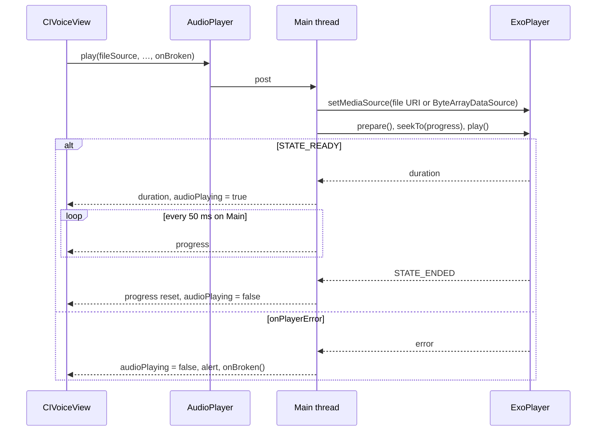
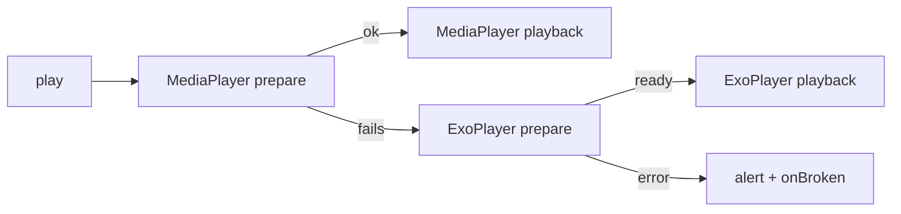

# Voice messages do not play on Huawei Mate X7 (Android)

## Report

| Field | Value |
|---|---|
| Device | HUAWEI Mate X7 (`DEL-LX9`) |
| OS | EMUI 15.0.0 (`15.0.0.167(C432E3R1P4)`) |
| Install | F-Droid and official APK, native |
| App | v7.0.4 (385) |
| Symptom | Play shows the "Unknown error" alert with `java.lang.IllegalStateException at android.media.MediaPlayer._prepare` from `AudioPlayer.start(RecAndPlay.android.kt:157)` |
| Exported file | plays in VLC |
| In-app video | plays |

Pending from the reporter:
- the compose preview of a new voice message, before sending: plays or fails;
- logcat line `MediaPlayer: error (x, y)` while play is tapped.

The camera part of the report is out of scope: the chat camera sends `MediaStore.ACTION_IMAGE_CAPTURE` (`GetImageView.android.kt:52`), and the device's camera app selects the lens.

## Facts

| # | Fact | Source |
|---|---|---|
| F1 | `prepare()` failure is caught; the trace is the alert text | `RecAndPlay.android.kt:157-161` |
| F2 | `setDataSource` succeeded before the failure | `RecAndPlay.android.kt:146-156` |
| F3 | Encrypted files are played through `CryptoMediaSource` (`MediaDataSource`) | `RecAndPlay.android.kt:148`, `:301` |
| F4 | Local file encryption is on by default | `SimpleXAPI.kt:141` |
| F5 | The compose preview plays a plain file path | `ComposeVoiceView.kt:56`, `RecAndPlay.android.kt:150` |
| F6 | Video uses ExoPlayer 2.19.1, already a dependency | `VideoPlayer.android.kt:40`, `common/build.gradle.kts:99` |
| F7 | ExoPlayer 2.19.1 throws `IllegalStateException` on calls from a thread other than its application looper (`throwsWhenUsingWrongThread = true` in the `ExoPlayerImpl` constructor) | `exoplayer-core-2.19.1.aar`, `javap` |
| F8 | `AudioPlayer.stop` is called from `Dispatchers.IO` | `SimpleXAPI.kt:837`, `:3143`, `:3785`, `:3812` |
| F9 | `AudioPlayer.play` is called from the `withBGApi` single-thread executor for remote files | `CIVoiceView.kt:73`, `Utils.kt:41` |
| F10 | The progress loop reads the player on `Dispatchers.Default` | `RecAndPlay.android.kt:167-169` |
| F11 | Failure is read synchronously after `play` returns | `CIVoiceView.kt:69`, `RecAndPlay.android.kt:264` |
| F12 | `ByteArrayDataSource` is in the shipped `exoplayer-datasource` 2.19.1 | `exoplayer-datasource-2.19.1.aar` |

## Decision D1 (open)

| Option | Engine | Devices that change | Code |
|---|---|---|---|
| A | `MediaPlayer`; ExoPlayer after a `prepare()` failure | only devices where `MediaPlayer` fails | both engines in `AudioPlayer`; every operation dispatches on the active engine |
| B (recommended) | ExoPlayer | all Android devices | one engine; `MediaPlayer` removed from playback |

## Mechanics of B

`AudioPlayer` (`RecAndPlay.android.kt:101-296`):
- `player`: one `ExoPlayer`, built on the main looper, audio attributes `USAGE_MEDIA`, `CONTENT_TYPE_MUSIC`, audio focus off.
- Each public method runs its player calls on `Dispatchers.Main`.
- Source:
  - encrypted file: `ProgressiveMediaSource` over `ByteArrayDataSource(readCryptoFile(path, cryptoArgs))`;
  - plain file: `ProgressiveMediaSource` over the file URI.
- Progress loop: `Dispatchers.Main`, 50 ms, as `VideoPlayer.android.kt:109-130`.
- Duration: set from `player.duration` at `STATE_READY`.
- Failure: `onPlayerError` sets `audioPlaying` to false, shows the alert, calls `onBroken`.
- End of track: `STATE_ENDED` replaces the `currentPosition == duration` check.
- `duration(unencryptedFilePath)` for the recorder: unchanged (`MediaPlayer` helper, elapsed time on failure).
- `AudioPlaybackCallback` that stops playback during calls: unchanged.

`AudioPlayerInterface.play` (`RecAndPlay.kt:31`):
- new parameter `onBroken: () -> Unit = {}`;
- `CIVoiceView.kt:69` replaced by `onBroken = { brokenAudio = true }`;
- `ComposeVoiceView.kt:56` uses the default;
- desktop calls it where `start` returns null (`RecAndPlay.desktop.kt:205`, `:218`).

## Mechanics of A, in addition to B

- `engine`: `MediaPlayer` or `ExoPlayer`, chosen per playback.
- `MediaPlayer` `prepare()` failure: playback restarts on ExoPlayer; the alert shows only after ExoPlayer fails.
- `pause`, `seekTo`, `stop`, progress loop: dispatch on `engine`.

## Verification

| # | Check | Device |
|---|---|---|
| V1 | Received encrypted voice message plays, pauses, seeks, ends | android-emu CI |
| V2 | Compose preview plays before sending | android-emu CI |
| V3 | Incoming deletion of the playing item stops playback without a wrong-thread exception | android-emu CI |
| V4 | Truncated audio file shows the alert and the broken icon | android-emu CI |
| V5 | Received voice message plays | reporter's Mate X7 |
