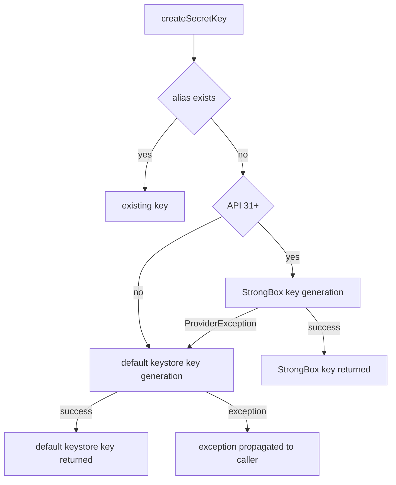

# Android: keystore key fallback after a StrongBox failure

## Problem

On a reported Android 12+ device, the app fails at the first start and shows "App crashed". Each start fails before the chat database is created.

Error:

```
java.security.ProviderException: Keystore key generation failed
Caused by: android.security.KeyStoreException: Unknown error (internal Keystore code: -1000 ...)
    1: Error::Km(r#UNKNOWN_ERROR)) (public error code: 10 internal Keystore code: -1000)
```

## Cause

A StrongBox key is requested first in `Cryptor.createSecretKey` (#7637). The default keystore is used only after `StrongBoxUnavailableException`. On the reported device, StrongBox key generation for AES-GCM failed with `ProviderException`, caused by KeyMint `UNKNOWN_ERROR` (public code 10, `ERROR_KEYMINT_FAILURE`). That exception is propagated through `initChatController` (Core.kt, `try`/`finally` without `catch`) to the coroutine of `withLongRunningApi`, which has no exception handler.

Callers of `createSecretKey`, through `KeyStoreItem.set`:

| Caller | Key |
|---|---|
| DatabaseUtils.useDatabaseKey | database passphrase, first start |
| DatabaseEncryptionView | database passphrase, change |
| DatabaseErrorView | database passphrase, entered after an error |
| MigrateToDevice | database passphrase, migration |
| SetAppPasscodeView | app passcode or self-destruct passcode, set |
| LocalAuthView | app passcode, after self-destruct |

## Change

`ProviderException` is caught around the StrongBox attempt in `createSecretKey`. `StrongBoxUnavailableException` is a subclass of it. The key is then generated in the default keystore. The full exception is logged as a warning.



## Scope

- Android only: Cryptor.android.kt.
- Existing keys are unchanged.
- An error from the default keystore is still propagated, as before #7637.
- The fallback is now logged at warning level, which is printed with developer tools off; before, it was logged at info level.

## Verification

- In AndroidKeyStoreKeyGeneratorSpi.java (android-36 sources), `KM_ERROR_HARDWARE_TYPE_UNAVAILABLE` is mapped to `StrongBoxUnavailableException` at line 413, and every other keystore error to `ProviderException` at line 415. The trace frame `AndroidKeyStoreKeyGeneratorSpi.java:415` is the second case.
- A device without StrongBox is expected to raise `StrongBoxUnavailableException` by the mapping at line 413, which master also catches. A test on such a device shows only that the existing fallback still works.
- The reported StrongBox fault can be reproduced only on the affected device model.
