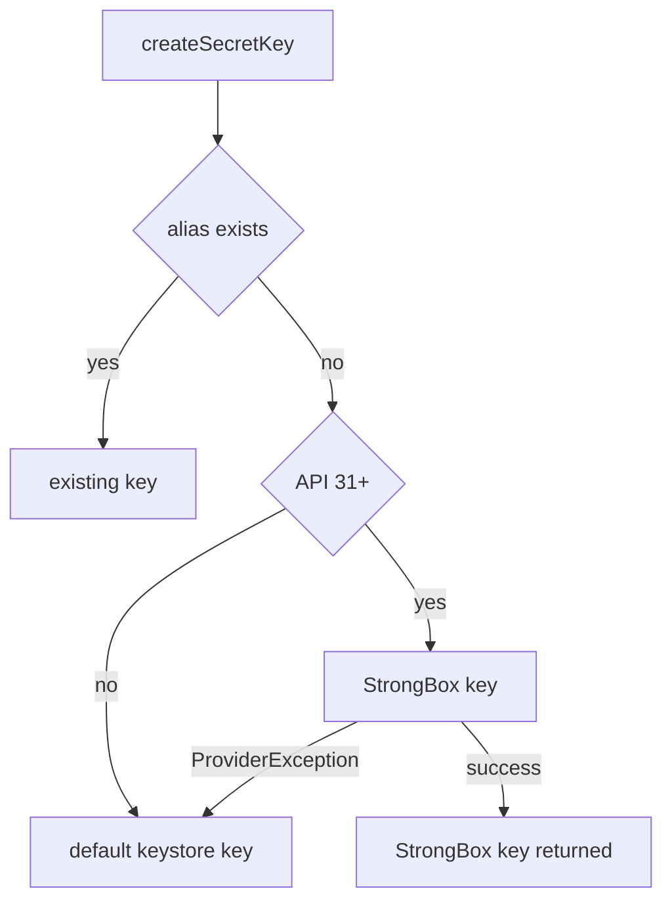

# Android: keystore key fallback after a StrongBox failure

## Problem

On some Android 12+ devices, the app fails at the first start and shows "App crashed". The chat database is never created, and each start repeats the failure.

Error:

```
java.security.ProviderException: Keystore key generation failed
Caused by: android.security.KeyStoreException: Unknown error (internal Keystore code: -1000 ...)
    1: Error::Km(r#UNKNOWN_ERROR)) (public error code: 10 internal Keystore code: -1000)
```

## Cause

`Cryptor.createSecretKey` requests a StrongBox key first (#7637). The default keystore is used only after `StrongBoxUnavailableException`. These devices report StrongBox, and their StrongBox fails AES-GCM key generation with `ProviderException`. That exception reaches `initChatController`, which has no `catch`.

Callers of `createSecretKey`, through `KeyStoreItem.set`:

| Caller | Key |
|---|---|
| DatabaseUtils.useDatabaseKey | database passphrase, first start |
| DatabaseEncryptionView | database passphrase, change |
| DatabaseErrorView | database passphrase, entered after an error |
| MigrateToDevice | database passphrase, migration |
| LocalAuthView | app passcode |

## Change

`createSecretKey` catches `ProviderException` around the StrongBox attempt. `StrongBoxUnavailableException` is a subclass of it. The key is then generated in the default keystore. The log records the full exception.



## Scope

- Android only: Cryptor.android.kt.
- Existing keys are unchanged.
- An error from the default keystore still propagates, as before #7637.
